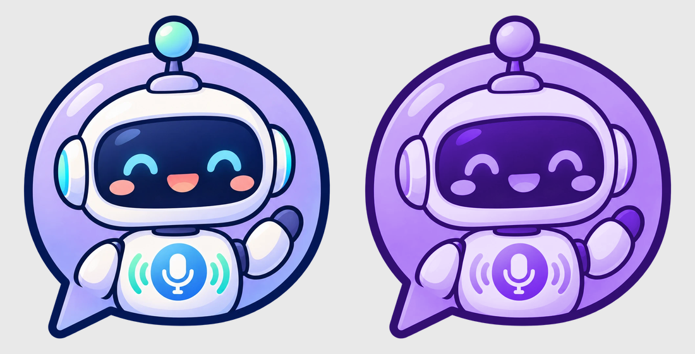

# ElevenFlow

**Wispr Flow–style voice typing for Android, powered by ElevenLabs speech-to-text.**

A small robot bubble floats over whatever app you're in. Talk to it, and your words get typed
into the text box you're using — WhatsApp, Telegram, Notes, a browser, anything. Text usually
lands a fraction of a second after you stop talking.

<p align="center"></p>

You bring your own [ElevenLabs](https://elevenlabs.io) API key. It's stored only on your phone
and sent only to ElevenLabs. There's no server in between, no account and no tracking.

---

## Contents

- [What it does](#what-it-does)
- [Install](#install)
- [Setup (2 minutes)](#setup-2-minutes)
- [Using it](#using-it)
- [Settings](#settings)
- [When things go wrong](#when-things-go-wrong)
- [Privacy and cost](#privacy-and-cost)
- [Troubleshooting](#troubleshooting)
- [Building from source](#building-from-source)
- [How it works](#how-it-works)

---

## What it does

- **One bubble, two gestures.** Tap it once to start and tap again to stop, *or* hold it down
  while you talk and let go to send. It tells them apart by how long you press.
- **Low latency.** Audio streams live to ElevenLabs' realtime model (Scribe v2 Realtime) while
  you speak, so the text is usually ready ~0.2–0.4 s after you stop.
- **Types for you.** The text is pasted into the focused text box. It is also always copied to
  the clipboard as a backup.
- **Long recordings work.** Several minutes of speech come back as one complete piece of text.
- **Nothing gets lost.** Every recording is saved on the phone. If the connection drops, it's
  re-sent automatically. If there's no signal at all, it waits in the app for you to retry.
- **Tells you when it couldn't paste.** If the text didn't land in a box (none was selected, or
  it arrived late), a notification appears: tap it to paste into whatever box you're in now.
- **Stays out of the way.** By default the bubble only appears while a keyboard is open, and it's
  see-through so you can read what's underneath.
- **Sound meter.** While recording, a small level meter appears next to the bubble so you know
  it's hearing you.
- **Custom words.** Teach it names and jargon it would otherwise mishear.
- **Foldable-friendly.** The bubble keeps its place when you fold or unfold the phone or rotate it.

---

## Install

1. Download `ElevenFlow.apk` from the [latest release](../../releases/latest) on your phone.
2. Open it and allow installing from your browser or file manager when Android asks.

Requires **Android 9 or newer**. It's developed and tested on Android 13–14.

---

## Setup (2 minutes)

Open ElevenFlow. The big button at the top always shows the next thing to do, and the ticks show
what's done.

1. **Paste your ElevenLabs API key** into the key field.
   - Get one at **elevenlabs.io → Developers → API keys**. If you restrict the key's permissions,
     it needs **Speech to Text** access.
2. **Allow microphone** (and notifications).
3. **Allow "draw over other apps"** so the bubble can float over other apps.
4. **Turn on auto-paste**: Settings → Accessibility → **ElevenFlow typing** → On.
   - If the toggle is **greyed out**, Android is blocking it because the app wasn't installed from
     the Play Store. Go to Settings → Apps → ElevenFlow → **⋮ (top right) → Allow restricted
     settings**, then try again.
   - Android will warn that an accessibility service can see your screen. ElevenFlow uses it for
     two things only: pasting text into the focused box, and noticing when a keyboard opens so the
     bubble can appear. It doesn't read or store anything else.
5. Tap **Start bubble**.

Tip: in your phone's battery settings, set ElevenFlow to **Unrestricted**. Otherwise some phones
(OnePlus, Xiaomi, Samsung) may shut the bubble down in the background.

---

## Using it

| You want to… | Do this |
|---|---|
| Dictate hands-free | **Tap** the bubble (it turns purple), talk, **tap** again to send |
| Push-to-talk | **Hold** the bubble while you talk, **let go** to send |
| Move the bubble | **Drag** it. Dragging never stops a recording that's in progress |
| See it's hearing you | Watch the sound meter that appears beside the bubble while recording |
| Get an old dictation | Open the app → **Recent**: tap any entry to copy it |
| Re-run a transcription | Open the app → **Recent** → **↻ transcribe again** under that entry |

- Recording starts the instant your finger touches the bubble, so nothing gets cut off at the start.
- A press shorter than 0.3 s counts as a tap; anything longer counts as a hold. You can change this
  in Settings.
- If you press and say nothing, nothing is typed and the recording is discarded.
- The always-on notification shows how long the last result took ("Last: 240 ms after stop").
  Tapping it opens the app. To switch the bubble off, use the **Stop bubble** button in the app.

---

## Settings

Everything applies instantly, even while the bubble is on screen.

| Setting | What it does | Default |
|---|---|---|
| **Size** | Bubble size, 36–110 dp | 60 dp |
| **See-through when idle** | How visible the bubble is when not recording | 37% |
| **See-through when recording** | How visible it is while recording | 65% |
| **Only show when the keyboard is up** | Hide the bubble unless you're typing somewhere | On |
| **Sound meter while recording** | The level meter beside the bubble | On |
| **Vibrate on start / stop** | A small buzz when recording starts and ends | On |
| **Tap vs hold** | Press length that counts as a hold, 150–800 ms | 300 ms |
| **Detect language** | Off = English only (slightly more accurate). On = auto-detect | Off |
| **Custom words** | Comma-separated names or jargon to recognise, e.g. `Kubernetes, Siobhan, PnL` | — |

---

## When things go wrong

ElevenFlow is built so a dictation is never silently lost:

| What happened | What ElevenFlow does |
|---|---|
| No text box was selected, or the app blocked pasting | Copies the text and shows **"Dictation ready — tap to paste"**. Tap it and the text goes into whatever box you're in now. **Copy** just copies it. |
| The connection dropped while you were talking, or the result was slow | Sends the saved recording again via ElevenLabs' file endpoint (a 75 s recording takes ~3 s), then pastes as normal |
| No signal at all | Keeps the recording and shows **"Not transcribed yet — tap to try again"**. Anything heard before the drop is put in the clipboard. You can also retry later from **Recent** in the app. |
| Android stopped the bubble | Brings it back automatically. If Android won't let it use the microphone yet, it shows **"tap to turn it on"**: one tap fixes it. |
| Android blocked the microphone (the recording is pure silence) | Shows **"Android blocked the mic — tap here, then dictate again"** |

---

## Privacy and cost

- **Your API key** is stored in the app's private storage on your phone. It's sent only to
  `api.elevenlabs.io`, and it's never included in this repository or in the released APK.
- **Your audio** goes straight from your phone to ElevenLabs for transcription, and nowhere else.
  See [ElevenLabs' privacy policy](https://elevenlabs.io/privacy). ElevenLabs' own request logging
  is left at its default.
- **Recordings and text** from your last 20 dictations are kept on the phone (app-private storage)
  so you can retry or copy them. Older ones are deleted automatically.
- **Cost:** transcription is billed to your ElevenLabs account according to your plan. Retries
  send the audio again, so they're billed again.

---

## Troubleshooting

**The accessibility toggle is greyed out.**
Settings → Apps → ElevenFlow → ⋮ → *Allow restricted settings*. Then turn it on in Accessibility.

**Text goes to the clipboard but isn't pasted.**
Check that auto-paste has a ✓ in the app. If a notification says "Dictation ready — tap to paste",
tap into the text box first, then tap the notification.

**"Message" (or another placeholder) appears before my text.**
Some chat apps report their grey placeholder as if it were real text. Common ones are handled
already. If you find another, open an issue with the app's name and the placeholder text.

**The bubble disappeared.**
Open ElevenFlow: it restarts the bubble. Set battery usage to Unrestricted so it isn't killed.
Avoid *Force stop* on the app's info page: on some phones it also switches off the accessibility
service, and you'll need to turn it on again.

**"HTTP 401" / "auth_error".**
The API key is wrong, expired, or lacks Speech to Text permission. Paste a new one in the app.

**It mishears names.**
Add them under **Custom words**.

---

## Building from source

Requirements: JDK 17 (the one bundled with Android Studio works) and the Android SDK (platform 34).

```bash
git clone https://github.com/deepbreathin/elevenflow.git
cd elevenflow
echo "sdk.dir=$HOME/Library/Android/sdk" > local.properties   # path to your Android SDK
./gradlew assembleDebug -PnoKey
# → app/build/outputs/apk/debug/app-debug.apk
```

`-PnoKey` builds without any key; users paste their own in the app.

**Optional, personal builds only:** put a fallback key in `secrets.properties` (git-ignored) so
you don't have to paste it in the app:

```properties
ELEVENLABS_API_KEY=sk_...
```

A key entered in the app always takes priority. Never share an APK built with a key in
`secrets.properties`, because anyone could extract the key from it.

The bubble artwork is generated from `art/robot.webp` by `art/make_bubble.py`.

---

## How it works

In short: the bubble records 16 kHz audio and streams it over a WebSocket to ElevenLabs' realtime
model. When you stop, it asks for the final text, then pastes it through an accessibility service.
Every recording is also saved as a WAV, which is the fallback if the live connection has any trouble.

The full technical write-up is in **[docs/HOW-IT-WORKS.md](docs/HOW-IT-WORKS.md)**. It covers the
architecture, the file-by-file map, the ElevenLabs quirks found while testing (long recordings,
replay speed limits, placeholder text), Android background rules, and how to test with the emulator.

---

## License

[MIT](LICENSE)
